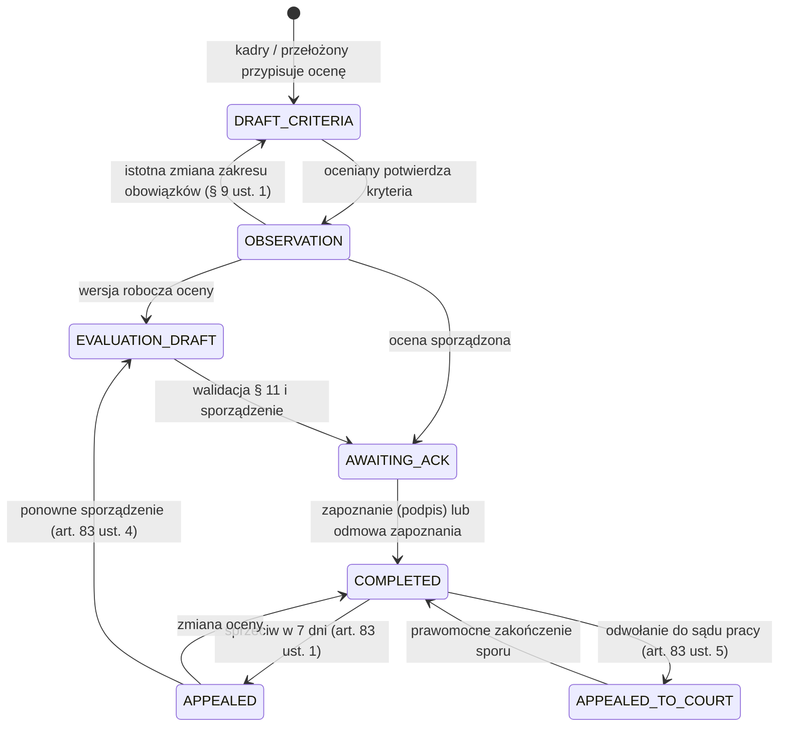
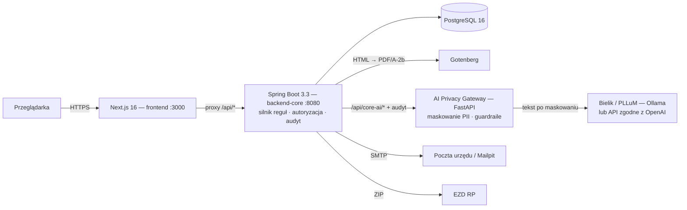

# MERITUM — Cyfrowy Asystent Ocen Okresowych w służbie cywilnej

> Ocena okresowa od rozmowy rozpoczynającej do arkusza w EZD RP — zgodnie z ustawą o służbie cywilnej, z regułami prawa
> zapisanymi jako kod i z AI, która pomaga człowiekowi, ale nigdy nie ocenia za niego.

**MERITUM** prowadzi pełny proces oceny okresowej członków korpusu służby cywilnej: ustalenie kryteriów, obserwację,
rozmowy, sporządzenie oceny, zapoznanie, sprzeciw, odwołanie do sądu pracy i archiwizację. Opiera się na ustawie
o służbie cywilnej (art. 81–83, 89, 108) i rozporządzeniu Prezesa Rady Ministrów z 4 kwietnia 2016 r. w sprawie ocen
okresowych. Każdy termin, blokada i wynik oceny wynika z reguł prawa w kodzie, a nie z pamięci kadr.

```
Kryteria → Obserwacja → Ocena → Zapoznanie → Zakończona → (Sprzeciw → Decyzja) → (Sąd pracy) → Archiwum / EZD RP
```

| | |
|---|---|
| **Dla kogo** | 1743 urzędy administracji rządowej — od ministerstwa po kilkuosobowy powiatowy inspektorat |
| **Role** | oceniający, oceniany, kadry, dyrektor generalny / kierownik urzędu, administrator KPRM |
| **Wynik** | arkusz A/B/C w PDF/A-2b 1:1 ze wzorem z rozporządzenia, paczka EZD (PDF + metadane), pełny audyt |
| **Stos** | Next.js 16 · Spring Boot 3.3 (Java 21) · PostgreSQL 16 · FastAPI · Gotenberg · Bielik / PLLuM przez Ollama |
| **Testy** | 178 testów backendu (w tym integracyjne na PostgreSQL) + 103 testy AI Gateway |
| **Licencje** | 100% open-source, bez płatnych komponentów |

---

## Spis treści

1. [Problem i rozwiązanie](#1-problem-i-rozwiązanie)
2. [Jak działa proces oceny](#2-jak-działa-proces-oceny)
3. [Co widzi każda rola](#3-co-widzi-każda-rola)
4. [Ekran cyklu oceny — 6 zakładek](#4-ekran-cyklu-oceny--6-zakładek)
5. [Silnik reguł prawa](#5-silnik-reguł-prawa)
6. [Prawo jako kod — nowelizacja bez programisty](#6-prawo-jako-kod--nowelizacja-bez-programisty)
7. [Wirtualny doradca HR — AI pod kontrolą człowieka](#7-wirtualny-doradca-hr--ai-pod-kontrolą-człowieka)
8. [Małe urzędy](#8-małe-urzędy)
9. [Dokumenty, integracje i powiadomienia](#9-dokumenty-integracje-i-powiadomienia)
10. [Prywatność, bezpieczeństwo i dostępność](#10-prywatność-bezpieczeństwo-i-dostępność)
11. [Architektura](#11-architektura)
12. [Uruchomienie](#12-uruchomienie)
13. [Scenariusz demo — 10 minut](#13-scenariusz-demo--10-minut)
14. [Testy i jakość](#14-testy-i-jakość)
15. [Struktura repozytorium](#15-struktura-repozytorium)
16. [Dokumentacja](#16-dokumentacja)

---

## 1. Problem i rozwiązanie

Dziś ocena okresowa to zwykle dokument Word, arkusz Excela z terminami i pamięć pracownika kadr. Typowe problemy:

| Problem | Jak rozwiązuje go MERITUM |
|---|---|
| Przegapione terminy (30 dni na kryteria, 7 dni na sprzeciw, 14 dni na decyzję) | terminy wyliczane automatycznie z uwzględnieniem dni wolnych (art. 115 KC), powiadomienia w aplikacji i e-mailem, drabina eskalacji |
| Błędy formalne w arkuszu (zła średnia, brak uzasadnienia przy ocenie negatywnej, wniosek o stopień przy 9. stopniu) | silnik reguł blokuje niezgodny arkusz i pokazuje, który warunek jest naruszony |
| Niespójne uzasadnienia, cudze nazwisko skopiowane z innego arkusza | deterministyczna kontrola spójności, sprawdzona na 10 arkuszach wzorcowych KPRM |
| Ocena „z ostatniego miesiąca” | notatki z obserwacji przez cały okres, przypomnienia kwartalne, ostrzeżenie o efekcie świeżości |
| Nowelizacja = zmiana szablonów w każdym urzędzie | wersjonowane schematy reguł publikowane centralnie, okresy przejściowe działają automatycznie |
| Obawy o AI i dane osobowe | AI wyłącznie doradcza, maskowanie danych osobowych przed modelem, audyt każdego wywołania, model lokalny |
| Mały urząd bez działu IT i bez dyrektora generalnego | tryb Mały Urząd: kierownik urzędu jako organ, konta lokalne, łączenie ról, wariant centralny (SaaS) |

---

## 2. Jak działa proces oceny



| Etap | Co się dzieje | Co robi system |
|---|---|---|
| **1. Przypisanie oceny** | kadry lub przełożony zakłada cykl — pojedynczo albo grupowo dla komórki | kreator dobiera arkusz A/B/C (§ 3), pokazuje termin oceny, termin kryteriów i wersję reguł, blokuje osoby niepodlegające ocenie okresowej |
| **2. Kryteria i rozmowa rozpoczynająca** | przełożony ustala kryteria obowiązkowe + 0–3 dodatkowe i oczekiwania; rozmowa (§ 5 ust. 1) | katalog 14 kryteriów z opisami zachowań, podpowiedź AI z opisu stanowiska, druk części I arkusza, zaproszenie `.ics` |
| **3. Potwierdzenie** | oceniany potwierdza zapoznanie z kryteriami | kryteria zostają zablokowane, cykl przechodzi w obserwację |
| **4. Obserwacja** | notatki z obserwacji, rozmowy bieżące, ankieta przed rozmową, przygotowanie ocenianego | przypomnienie po 90 / 120 dniach bez aktywności, wirtualny doradca HR, zmiana terminu (art. 81 ust. 8) i zakresu obowiązków |
| **5. Ocena i rozmowa oceniająca** | oceny cząstkowe 1/3/5/7/9, uzasadnienie, IPRZ, ew. wniosek o stopień (cz. III) | silnik reguł wylicza średnią, poziom i wynik; walidacja § 11 blokuje błędny arkusz; kontrola spójności i asystent sokratejski |
| **6. Zapoznanie** | oceniany zapoznaje się i podpisuje (albo odmawia — fikcja zapoznania) | skrót SHA-256 treści arkusza, kod weryfikacyjny na wydruku, termin sprzeciwu +7 dni, wpis do historii ocen |
| **7. Sprzeciw** | oceniany wnosi sprzeciw; DG / kierownik urzędu rozstrzyga w 14 dni | zmiana oceny — dalej tylko sąd pracy; ponowne sporządzenie — nowy termin i ponowne prawo do sprzeciwu |
| **8. Sąd pracy i archiwum** | kadry rejestrują odwołanie; ocena trafia do akt | blokada archiwalna na czas sporu, retencja części B akt (10 / 50 lat), paczka EZD, czyszczenie danych pomocniczych |
| **9. Kolejny cykl** | po ocenie pozytywnej — zwykły cykl; po negatywnej — ponowna ocena po 6 miesiącach | „Rozpocznij kolejny cykl” z właściwą datą i najnowszą wersją reguł |

Ocena po terminie **nie jest blokowana** (ustalenie z mentorami KPRM): system zapisuje przyczynę opóźnienia, umieszcza ją
na wydruku i eskaluje zaległość — 1–7 dni oceniający, 8–14 zastępca, 15–30 kadry, ponad 30 dni dyrektor generalny
(albo kierownik urzędu).

---

## 3. Co widzi każda rola

### Oceniający (bezpośredni przełożony)
- **Pulpit** z cyklami zespołu, stanem terminu (w terminie / zbliża się / po terminie) i oznaczeniem osób uprawnionych do
  obligatoryjnego kolejnego stopnia (art. 89 ust. 2); „+ Przypisz nową ocenę (utwórz cykl)”.
- **Mój zespół** (`/team`) — mapa kompetencji z ostatnich ocen cząstkowych, propozycje par mentor–uczący się,
  sygnały przeciążenia (nieobecności, notatki, brak kontaktu).
- Prowadzenie całego cyklu: notatki z obserwacji, rozmowy bieżące, przygotowanie do rozmów z AI, IPRZ.
- **Zastępstwa** — w czasie nieobecności oceniającego zastępca widzi i prowadzi jego cykle (audyt oznacza działanie „w zastępstwie”).

### Oceniany
- Potwierdzenie kryteriów, wgląd w notatki udostępnione po ocenie, przygotowanie do rozmowy (osiągnięcia, trudności,
  potrzeby rozwojowe — udostępniane przełożonemu tylko za zgodą), odpowiedzi na ankietę przed rozmową.
- **Zapoznanie i podpis**: podpis kwalifikowany / Profil Zaufany / mObywatel, pieczęć systemowa albo tryb papierowy ze skanem.
- **Sprzeciw** w terminie, wniosek o zmianę terminu oceny (art. 81 ust. 8 pkt 4), zapoznanie z IPRZ.
- **Prywatny dziennik** — notatki widoczne wyłącznie dla autora, poza aktami i eksportami.

### Kadry
- **Panel Kadr** (`/hr`): lista pracowników z wyszukiwaniem, edycja danych (status zatrudnienia, opis stanowiska, data
  zatrudnienia, stopień służbowy), import CSV, zmiana przełożonego z przekazaniem cykli (§ 9 ust. 3).
- **Zaległości i drabina eskalacji**, **alerty kadrowe** (dwie oceny negatywne urzędnika SC — art. 71 ust. 1 pkt 1;
  obowiązek przyznania stopnia — art. 89 ust. 2), rejestr nieobecności z przeliczeniem terminu (art. 81 ust. 7).
- **Historia ocen** w oknie modalnym z linkami „Otwórz arkusz” i „Pobierz PDF”; dopisywanie ocen sprzed wdrożenia.
- **RODO**: eksport danych pracownika (art. 15), usunięcie albo anonimizacja z zachowaniem arkuszy.
- **Raporty**: CSV do Sprawozdania Szefa Służby Cywilnej, plan szkoleń z zatwierdzonych IPRZ, kalibracja ocen per
  komórka, przypomnienia e-mail na żądanie, czyszczenie danych pomocniczych zamkniętych cykli.
- **Tryb korekty** — cofnięcie cyklu o etap z obowiązkowym uzasadnieniem i pełnym śladem w audycie.

### Dyrektor generalny / kierownik urzędu
- Rozpatrywanie sprzeciwów (zmiana oceny albo ponowne sporządzenie), zatwierdzanie IPRZ (art. 108).
- **Statystyki** (`/stats`) — rozkład ocen, poziomów i dobrostanu wyłącznie jako dane zbiorcze z k-anonimizacją (k = 5).
- **Rejestr zdarzeń** (`/audit`) z filtrem „Tylko interakcje AI”.

### Administrator KPRM
- **Administracja** (`/admin`) — wizualny kreator wersji reguł („prawo jako kod”) bez ręcznej edycji JSON-a, pakiety
  reguł do pobrania, urzędy i tryb Mały Urząd, konta lokalne i łączenie ról.

### Wszyscy
- **Archiwum** (`/archive`) — zakończone oceny widoczne dla danej roli, filtry (rok, komórka, wynik, imię i nazwisko),
  znacznik retencji, podgląd, PDF i paczka EZD (ZIP).
- **Dobrostan** (`/wellbeing`) — anonimowa ankieta (obciążenie, energia, wsparcie).
- **Powiadomienia** (dzwonek w nagłówku) — terminy, sprzeciwy, ankiety, alerty — wyliczane na bieżąco.

---

## 4. Ekran cyklu oceny — 6 zakładek

Każdy cykl (`/cycles/{id}`) ma pasek postępu procesu, informację o widoczności danych i sześć zakładek:

| Zakładka | Zawartość |
|---|---|
| **1. Kryteria** | kryteria obowiązkowe dla arkusza + do 3 dodatkowych z opisami zachowań (zał. nr 1), oczekiwania na poziomie 5 pkt, data rozmowy rozpoczynającej, „AI: Podpowiedz kryteria i oczekiwania”, „Drukuj wyłącznie Część I (PDF)”, „Potwierdź zapoznanie z kryteriami” |
| **2. Notatki** | oś czasu notatek z obserwacji, fakty policzone z bazy (nieobecności, zmiany zakresu, notatki o przeciążeniu) i „Analizuj z wirtualnym doradcą HR” — sygnał ryzyka przeciążenia, pytania otwierające rozmowę, propozycje organizacyjne, moment docenienia |
| **3. Rozmowa i ankieta** | „AI: Przygotuj rozmowę” (rozpoczynającą / oceniającą / bieżącą: agenda z podstawą prawną, trudne scenariusze, karta trudnej rozmowy), „AI: Przygotuj komunikat doceniający” (model SBI), przygotowanie ocenianego, rozmowy bieżące, zwinięta ankieta przed rozmową, zaproszenie `.ics` |
| **4. Ocena i IPRZ** | skala 1/3/5/7/9 z podglądem średniej, uzasadnienie, „Sokratejskie AI” (pytania zamiast gotowych ocen), „Kontrola spójności”, IPRZ z „AI: Podpowiedz działania rozwojowe” (70-20-10), wniosek o stopień (cz. III), przyczyna opóźnienia po terminie |
| **5. Zapoznanie i PDF** | podpis lub odmowa zapoznania, „Złóż sprzeciw” i rozstrzygnięcie organu, rejestracja odwołania do sądu pracy (blokada archiwalna), PDF/A całości i części I, metadane i „Pobierz paczkę EZD RP (.zip)” |
| **6. Zmiany i korekty** | zmiana terminu oceny (4 przesłanki z art. 81 ust. 8 i pismo zawiadomienia z § 8), zmiana zakresu obowiązków (§ 9 / art. 81 ust. 6), szczegóły cyklu, tryb korekty |

---

## 5. Silnik reguł prawa

Logika prawa (`backend-core/src/main/java/pl/gov/kprm/oceny/rules/`) to czyste klasy bez bazy danych i frameworka —
każdą regułę da się przetestować jednostkowo, a frontend jej nie powiela (wynik zawsze pochodzi z backendu).

| Reguła | Podstawa | Implementacja |
|---|---|---|
| Arkusz A / B / C | § 3 rozporządzenia | kierownik urzędu / bezpośrednie kierowanie pracownikami / pozostałe stanowiska |
| Kryteria obowiązkowe + 0–3 dodatkowe z katalogu, bez powtórzeń | § 4–5, zał. nr 1 | `CriteriaCatalog` |
| Skala 1, 3, 5, 7, 9; poziomy wg średniej (≤ 2, ≤ 4, ≤ 6, ≤ 8, ≤ 9), liczone bez zaokrągleń | § 11 | `EvaluationRuleEngine` |
| Ocena negatywna: poziom poniżej oczekiwań **lub** którakolwiek ocena = 1 (z wyjaśnieniem) | § 11 | `EvaluationRuleEngine` |
| Uzasadnienie przy ocenie negatywnej, IPRZ zawsze, cz. III tylko dla urzędnika SC przy ocenie pozytywnej i stopniu < 9 | § 11 ust. 5 | walidacja przy sporządzeniu (HTTP 422 z listą naruszeń) |
| Terminy w miesiącach i dniach; sobota / niedziela / święto → następny dzień roboczy | art. 115 KC, dokument KPRM „liczenie terminów” | `DeadlineService` (święta stałe i ruchome, Wigilia od 2025 r.) |
| Kryteria 30 dni (7 po ocenie negatywnej), sprzeciw 7 dni, rozstrzygnięcie 14 dni, stopień 30 dni | § 7, art. 83, art. 89 | `DeadlineService`, `SchemaRules` |
| Nieobecność ciągła > 1 mies. przedłuża ocenę; nie przedłuża 6-miesięcznej ponownej oceny | art. 81 ust. 7 i 9 | łączenie nieobecności rozdzielonych tylko dniami wolnymi |
| Zmiana terminu oceny — 4 przesłanki, tylko gdy od ostatniej oceny minęło > 6 mies. | art. 81 ust. 8, § 8 | `RescheduleRules` + treść zawiadomienia |
| Obligatoryjny kolejny stopień po dwóch ocenach „powyżej” / „znacznie powyżej oczekiwań” | art. 89 ust. 2 | `GradeRules` |
| Dwie kolejne oceny negatywne urzędnika SC → alert krytyczny dla kadr i DG | art. 71 ust. 1 pkt 1 | `EmploymentAlertRules` |
| Kto podlega ocenie: urzędnik SC i pracownik SC na czas nieokreślony; umowa na czas określony — pierwsza ocena z art. 37–38; wyższe stanowisko SC — bez oceny okresowej | art. 35, 37–38, 81 | `EmploymentStatus` |
| Organ rozpatrujący sprzeciw: dyrektor generalny albo kierownik urzędu | art. 25 ust. 9, art. 83 | `AppealAuthority` |
| Retencja arkusza: 10 lat / 50 lat, blokada przy sporze sądowym | część B akt osobowych | `RetentionRules` |

---

## 6. Prawo jako kod — nowelizacja bez programisty

Zmienne elementy prawa są zapisane w **wersjach schematu**: katalog kryteriów z opisami, obowiązkowość dla arkuszy
A/B/C, okres oceny, limit kryteriów dodatkowych, kryteria własne, terminy i progi poziomów.

1. Administrator KPRM w `/admin` otwiera kreator wypełniony najnowszą wersją.
2. Wprowadza zmiany z nowelizacji i datę wejścia w życie (np. `v2` od 1.01.2027).
3. Backend waliduje wersję — błędna jest odrzucana, poprawna zostaje opublikowana jako niezmienna.
4. Od dnia wejścia w życie nowe cykle dostają `v2`; cykle rozpoczęte na `v1` kończą się według `v1` (§ 13).
5. Instalacje lokalne dostają tę samą wersję jako pakiet `meritum-rules-v2.json`.

Bez wdrożenia kodu, bez przestoju i bez ręcznej zmiany szablonów w urzędach. Demo zawiera `v1` (obecne przepisy) i `v2`
od 2027 r. (z dozwolonymi kryteriami własnymi). Procedurę krok po kroku opisuje
[docs/wdrozenie-i-bezpieczenstwo.md](docs/wdrozenie-i-bezpieczenstwo.md#7-prawo-jako-kod--aktualizacja-przy-nowelizacji).

---

## 7. Wirtualny doradca HR — AI pod kontrolą człowieka

AI pomaga **przygotować się**, **zadać właściwe pytania** i **znaleźć niespójności**. Nie wystawia ocen, nie proponuje
punktów i niczego nie zapisuje w arkuszu.

| Funkcja | Co robi |
|---|---|
| **Podpowiedź kryteriów** | do 3 kryteriów dodatkowych z katalogu (spoza obowiązkowych) z propozycją oczekiwań — na podstawie opisu stanowiska |
| **Przygotowanie do rozmowy** | agenda rozmowy rozpoczynającej (§ 5 ust. 1), oceniającej (§ 10) lub bieżącej, trudne scenariusze (spadek wyników, ocena negatywna, przeciążenie), katalog działań rozwojowych 70-20-10 |
| **Sokratejskie AI** | pytania pomagające napisać uzasadnienie oparte na faktach i szkic do samodzielnej edycji — bez sugestii punktów |
| **Kontrola spójności** | reguły, nie LLM: niezgodne kryteria, obce nazwisko, poziom lub średnia niezgodne z ocenami, powielony tekst, niezgodna forma gramatyczna, efekt świeżości, niedawna zmiana zakresu obowiązków |
| **Wirtualny doradca HR** | na podstawie faktów z bazy (nieobecności, zmiany zakresu, notatki) — sygnał ryzyka przeciążenia i pytania otwierające |
| **Docenienie (SBI)** | sytuacja – zachowanie – wpływ: konkretna informacja zwrotna przed oceną |
| **Mentoring zespołu** | pary mentor–uczący się na podstawie mocnych stron i obszarów rozwoju (reguły) |

**Gwarancje** (EU AI Act, zał. III pkt 4 — system wysokiego ryzyka w obszarze zatrudnienia):

- **Maskowanie danych osobowych przed modelem** — imiona i nazwiska (również odmienione i wersalikami), e-maile, PESEL,
  telefony, komórki organizacyjne; użytkownik widzi dokładnie to, co trafiło do modelu.
- **Pełny audyt** — każde wywołanie przechodzi przez backend i zapisuje wpis `AI_*` z treścią po maskowaniu.
- **Oznaczenie treści AI** — każda odpowiedź ma zastrzeżenie i metadane zgodności (decyduje człowiek, AI tylko doradza).
- **Działa bez internetu** — model lokalny (Bielik / PLLuM przez Ollama) albo odpowiedzi deterministyczne, gdy modelu nie ma.

---

## 8. Małe urzędy

Większość z 1743 urzędów to małe jednostki — inspektoraty, urzędy powiatowe — bez działu IT i bez dyrektora generalnego.

- **Urząd bez DG** — sprzeciw rozpatruje kierownik urzędu; nazwa organu, pouczenie w PDF (z art. 25 ust. 9 ustawy o SC)
  i drabina eskalacji dostosowują się automatycznie.
- **Konta lokalne** — logowanie hasłem (BCrypt) włączane dla wybranego urzędu, gdy nie ma Active Directory.
- **Łączenie ról** — jedna osoba może być jednocześnie kierownikiem urzędu, oceniającym i kadrami.
- **Wariant centralny (SaaS)** — instancja utrzymywana przez KPRM: mały inspektorat potrzebuje tylko przeglądarki.

W demo: **Powiatowy Inspektorat Weterynarii w Płocku** (3 osoby, bez DG, tryb Mały Urząd włączony).

---

## 9. Dokumenty, integracje i powiadomienia

| Wyjście | Opis |
|---|---|
| **PDF/A-2b arkusza** | 1:1 ze wzorem (cz. I–III, średnia z przecinkiem, tabela przyznania oceny, pouczenie o sprzeciwie), przyczyna opóźnienia, adnotacja o podpisie, kod weryfikacyjny; osobno część I po rozmowie rozpoczynającej |
| **Paczka EZD RP** | ZIP z PDF/A i metadanymi (strony, status, podpis, podstawa prawna, retencja) — dane pomocnicze jawnie wyłączone |
| **Kalendarz** | zaproszenie `.ics` (RFC 5545) na rozmowę rozpoczynającą / oceniającą, aktualizowane po zmianie terminu |
| **E-mail** | przedłużenie terminu, ponowne sporządzenie po sprzeciwie, alert krytyczny dla kadr i DG, codzienne zbiorcze przypomnienia o terminach; w demo przechwytywane przez Mailpit |
| **Raporty CSV** | zestawienie sprawozdawcze z k-anonimizacją, dane do Sprawozdania Szefa Służby Cywilnej |
| **Pismo** | zawiadomienie o zmianie terminu oceny (§ 8) generowane z danych cyklu |

---

## 10. Prywatność, bezpieczeństwo i dostępność

**Prywatność (RODO)**
- Izolacja urzędów i uprawnienia wynikające z relacji do cyklu (oceniający, zastępca, oceniany) — nie tylko z roli.
- Statystyki wyłącznie jako dane zbiorcze z k-anonimizacją (k = 5) egzekwowaną w backendzie.
- Ankieta dobrostanu technicznie anonimowa: bez identyfikatora osoby, data bez godziny, bez audytu.
- Arkusz to część B akt osobowych — nigdy nie jest usuwany automatycznie (10 / 50 lat, blokada przy sporze sądowym).
- Zakaz „czarnych teczek”: notatki robocze i ankiety są usuwane po zamknięciu cyklu i nie trafiają do archiwum.

**Bezpieczeństwo**
- JWT HS256; symulowane logowanie demo wyłączone domyślnie (`GOV_LOGIN_ENABLED=false`); docelowo Węzeł Krajowy
  (login.gov.pl / mObywatel) i Active Directory przez OIDC / SAML.
- Limity żądań dla logowania i AI, limit rozmiaru żądań AI (64 KB), nagłówki bezpieczeństwa, brak sekretów w repozytorium.
- Kontenery bez uprawnień administratora; AI Gateway i Gotenberg bez portów zewnętrznych.
- Testy IDOR, eskalacji uprawnień, izolacji urzędów, wstrzyknięć i ataków na JWT; skrypt obciążeniowo-atakowy.

**Dostępność (WCAG 2.1 AA)**
- 4 motywy (jasny, ciemny, dwa wysokokontrastowe), filtry dla osób z zaburzeniami widzenia barw, skalowanie 85–175%,
  czcionka przyjazna przy dysleksji.
- Pełna obsługa klawiaturą (`Alt+A` — panel dostępności), regiony `aria-live`, statusy rozróżniane nie tylko kolorem.
- Interfejs w całości po polsku, w stylu gov.pl.

Szczegóły, szkic DPIA i warianty wdrożenia: [docs/wdrozenie-i-bezpieczenstwo.md](docs/wdrozenie-i-bezpieczenstwo.md).

---

## 11. Architektura



| Warstwa | Technologia | Rola |
|---|---|---|
| Frontend | Next.js 16 (App Router), React 19, TypeScript, Tailwind 3 | interfejs w stylu gov.pl; rozmawia wyłącznie z własnym proxy `/api/*` |
| Backend | Java 21, Spring Boot 3.3, Spring Data JPA, Flyway | silnik reguł prawa, maszyna stanów, autoryzacja, audyt, PDF, EZD, e-mail, harmonogramy |
| Baza | PostgreSQL 16 | dane procesu, wersje schematu (JSONB), audyt; schemat zmieniają wyłącznie migracje |
| AI Gateway | Python 3.11, FastAPI, Pydantic | maskowanie danych osobowych, asystenci, kontrola spójności, guardraile; dostęp tylko z backendu |
| PDF | Gotenberg 8 (Chromium) | konwersja HTML arkusza do PDF/A-2b |
| LLM (opcjonalnie) | Ollama + Bielik / PLLuM (Apache 2.0) | model lokalny — dane nie opuszczają infrastruktury |
| Poczta (demo) | Mailpit | podgląd wysłanych e-maili |

---

## 12. Uruchomienie

Wymagany Docker (Docker Desktop albo Docker Engine z Compose).

```bash
make up                 # tworzy infra/.env z infra/.env.example, buduje i uruchamia wszystkie kontenery
open http://localhost:3000
```

Bez `make`:

```bash
cp infra/.env.example infra/.env
docker compose -f infra/docker-compose.yml up -d --build --wait
```

| Polecenie | Działanie |
|---|---|
| `make down` | zatrzymanie kontenerów |
| `make reset` | zatrzymanie i usunięcie danych (seed demo wgra się ponownie) |
| `make logs` / `make ps` | logi / stan kontenerów |
| `docker compose -f infra/docker-compose.yml --profile local-llm up -d` | dodatkowo lokalny model językowy (Ollama) |

### Adresy

| Usługa | Adres | Dostęp |
|---|---|---|
| **Aplikacja** | **http://localhost:3000** | przeglądarka |
| Backend API | http://localhost:8080/api/health | tylko `127.0.0.1` |
| Swagger UI | http://localhost:8080/swagger-ui.html | tylko `127.0.0.1` |
| Mailpit (skrzynka testowa) | http://localhost:8025 | tylko `127.0.0.1` |
| AI Privacy Gateway | `http://ai-gateway:8000` | wyłącznie sieć Dockera — AI tylko przez audytowane `/api/core-ai/*` |
| Gotenberg | `http://gotenberg:3000` | wyłącznie sieć Dockera |
| PostgreSQL | `127.0.0.1:5432` | tylko lokalnie |

### Konta demo

Przy pierwszym uruchomieniu aplikacja loguje automatycznie jako kierownik (symulacja Węzła Krajowego — tylko w demo).
Konto zmienia się w nagłówku: **„Zmień konto”**.

**Ministerstwo Cyfryzacji — Demo** (urząd z dyrektorem generalnym)

| ID | Osoba | Rola | Co pokazuje |
|---|---|---|---|
| 1 | Anna Kowalska | Dyrektor generalny | sprzeciwy, zatwierdzanie IPRZ, statystyki (wyższe stanowisko SC — bez oceny okresowej) |
| 2 | Piotr Nowak | Kierownik (oceniający) | pełny proces oceny, cykle po terminie, „Mój zespół”, wirtualny doradca HR |
| 6 | Tomasz Wójcik | Kierownik (oceniający) | drugi zespół (Wydział Analiz i Danych), mapa kompetencji i mentoring |
| 3 | Katarzyna Wiśniewska | Oceniana (urzędnik SC) | potwierdzenie kryteriów, zapoznanie, sprzeciw |
| 4 | Marek Zieliński | Kadry | panel kadr, alerty, archiwum, przypomnienia, retencja |
| 5 | Ewa Lewandowska | Administrator KPRM | wersje reguł, urzędy, konta lokalne |
| 20 | Oliwia Wrona | Oceniana (umowa na czas określony) | blokada oceny okresowej (art. 37–38 w zw. z art. 35 ust. 3) |
| 21 | Grzegorz Sikora | Oceniany (urzędnik SC) | dwie oceny negatywne — alert krytyczny (art. 71 ust. 1 pkt 1) |

**Powiatowy Inspektorat Weterynarii w Płocku — Demo** (Mały Urząd: bez DG, logowanie hasłem włączone)

| ID | Osoba | Rola | Co pokazuje |
|---|---|---|---|
| 17 | Halina Sowa | Kierownik urzędu | organ rozpatrujący sprzeciw w urzędzie bez DG |
| 18 | Dariusz Kowal | Kierownik (oceniający) | przypomnienie kwartalne, ankieta przed rozmową |
| 19 | Kinga Lis | Oceniana | odpowiedzi na ankietę, prywatny dziennik |

Seed nie zawiera haseł. Aby pokazać konto lokalne: administrator KPRM (ID 5) ustawia hasło w `/admin` → „Konta lokalne —
tryb Mały Urząd” (min. 12 znaków, litera i cyfra), a potem w oknie logowania wybierz „Konto lokalne urzędu”.

---

## 13. Scenariusz demo — 10 minut

1. **Pulpit kierownika** (Piotr Nowak) — cykle zespołu ze stanem terminu; cykle po terminie z eskalacją.
   „+ Przypisz nową ocenę (utwórz cykl)” pokazuje dobór arkusza, wyliczony termin i wersję reguł.
2. **Kryteria** — w cyklu na etapie „Kryteria”: kryteria obowiązkowe z opisami, „AI: Podpowiedz kryteria i oczekiwania”
   z widoczną treścią po maskowaniu, „Drukuj wyłącznie Część I (PDF)”.
3. **Potwierdzenie** — zmień konto na ocenianego i kliknij „Potwierdź zapoznanie z kryteriami”; cykl przechodzi w obserwację.
4. **Notatki** — dodaj notatkę, kliknij „Analizuj z wirtualnym doradcą HR”: fakty z bazy → sygnał ryzyka i pytania na rozmowę.
5. **Ocena** — wpisz oceny cząstkowe z jedną oceną 1: silnik reguł daje ocenę negatywną i wymaga uzasadnienia.
   „Kontrola spójności” wskazuje problemy, „Sokratejskie AI” zadaje pytania zamiast podawać punkty.
6. **Zapoznanie** — jako oceniany podpisz ocenę; pobierz PDF/A z kodem weryfikacyjnym i „Pobierz paczkę EZD RP (.zip)”.
7. **Sprzeciw** — „Złóż sprzeciw”; jako dyrektor generalny (Anna Kowalska) wybierz ponowne sporządzenie — nowy termin
   i e-mail w Mailpicie (http://localhost:8025).
8. **Kadry** (Marek Zieliński) — alert krytyczny dla Grzegorza Sikory (art. 71), zaległości z drabiną eskalacji,
   „Historia ocen”, archiwum ocen, przypomnienia e-mail.
9. **Prawo jako kod** (Ewa Lewandowska) — `/admin`: kreator nowej wersji reguł i pakiet do pobrania.
10. **Mały Urząd** — Halina Sowa / Dariusz Kowal (Płock): urząd bez DG, nazwa organu w pouczeniu, przypomnienie kwartalne.
11. **Audyt i dostępność** — `/audit` → „Tylko interakcje AI”; `Alt+A` → motyw wysokokontrastowy, filtr barw, powiększenie.

Po demo `make reset` przywraca dane początkowe.

---

## 14. Testy i jakość

| Moduł | Testy | Polecenie |
|---|---|---|
| backend-core — reguły prawa, PDF, eksporty, JWT, limity żądań, serwisy + integracyjne na PostgreSQL (Testcontainers): proces, bezpieczeństwo (IDOR, izolacja urzędów, wstrzyknięcia), zgodność prawna, mały urząd, prywatność | **178** | `make build` (`mvn verify`, wymaga Dockera) |
| ai-gateway — maskowanie danych osobowych, spójność na 10 arkuszach wzorcowych KPRM, API, podpowiedzi kryteriów, doradca HR, bezpieczeństwo (prompt injection, limit 64 KB, DoS) | **103** | `make test-ai` |
| frontend — TypeScript i build produkcyjny | — | `make build-fe` |
| obciążenie i scenariusze ataku na działający stos | — | `make loadtest` (potem `make reset`) |

- Regresja kontroli spójności: 10 arkuszy wzorcowych KPRM — 5 z 5 celowo umieszczonych błędów wykrytych, 0 fałszywych alarmów.
- Luki z audytu bezpieczeństwa mają testy regresyjne; nowa luka = najpierw test, potem poprawka.
- Testy integracyjne backendu uruchamiają wszystkie migracje na prawdziwym PostgreSQL.

---

## 15. Struktura repozytorium

```
.
├── backend-core/      # Java 21 / Spring Boot — reguły prawa (rules/), serwisy, API, PDF, eksporty, migracje Flyway
├── ai-gateway/        # Python / FastAPI — maskowanie danych osobowych, asystenci AI, kontrola spójności, guardraile
├── frontend/          # Next.js 16 / React 19 — interfejs gov.pl, dostępność, widoki wszystkich ról
├── infra/             # docker-compose.yml i .env.example
├── loadtest/          # obciążenie i scenariusze ataku (biblioteka standardowa Pythona)
├── docs/              # analiza materiałów KPRM, wdrożenie i bezpieczeństwo
├── Makefile           # make up / down / reset / logs / build / test / test-ai / build-fe / loadtest
└── CLAUDE.md          # szczegółowa mapa kodu, pełna lista endpointów API, maszyna stanów i zasady pracy
```

---

## 16. Dokumentacja

- [Wdrożenie, bezpieczeństwo, RODO / DPIA, AI Act, dostępność, procedura „prawo jako kod”](docs/wdrozenie-i-bezpieczenstwo.md)
- [Analiza oficjalnych materiałów KPRM](docs/analiza-kprm.md) — akty prawne, przypadki użycia, BPMN, wzory i arkusze wzorcowe
- [CLAUDE.md](CLAUDE.md) — struktura kodu, wszystkie endpointy API, reguły prawne i zasady pracy
- Swagger UI po uruchomieniu: http://localhost:8080/swagger-ui.html
