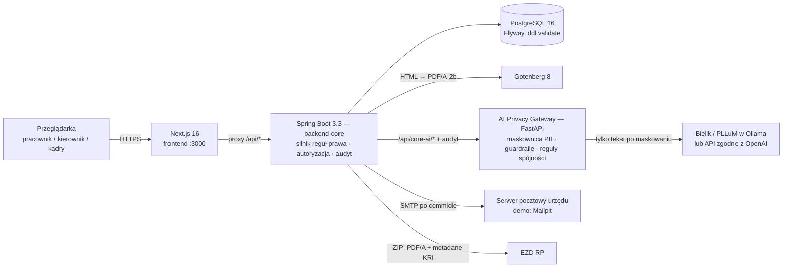

# MERITUM — wdrożenie, bezpieczeństwo, RODO, AI Act i dostępność

Dokument dla Biura Informatyki oraz Departamentu Służby Cywilnej KPRM. Opisuje architekturę, warianty wdrożenia
w urzędach administracji rządowej, docelowe uwierzytelnianie, ochronę danych (ze szkicem DPIA), zgodność z AI Act,
dostępność cyfrową i procedurę aktualizacji prawa. Oznaczenia: **[jest]** — zaimplementowane i pokryte testami,
**[docelowo]** — element wdrożenia produkcyjnego, którego nie ma w wersji demonstracyjnej.

## 1. Architektura



Wersja tekstowa:

```
Przeglądarka ──HTTPS──> Next.js (:3000) ──/api/*──> Spring Boot backend-core (:8080)
                                                      ├── PostgreSQL (dane, audyt, wersje schematu)
                                                      ├── Gotenberg ── PDF/A-2b arkusza 1:1 ze wzorem
                                                      ├── AI Privacy Gateway (:8000, sieć wewnętrzna)
                                                      │      └── PiiMasker ──> Bielik/PLLuM (Ollama) lub API
                                                      ├── SMTP (przypomnienia, alerty, zmiany terminów)
                                                      └── EZD RP (paczka ZIP: PDF/A + metadane KRI)
```

Zasady architektoniczne **[jest]**:

- Przeglądarka komunikuje się wyłącznie z Next.js; adresy usług wewnętrznych nie są znane klientowi (brak CORS).
- Na hoście dostępne są tylko frontend (3000) i backend (8080, tylko `127.0.0.1`). Gotenberg i AI Gateway nie mają
  portów zewnętrznych; AI jest dostępna wyłącznie przez backend (`/api/core-ai/*`), który zapisuje każde wywołanie w audycie.
- Logika prawa (`rules/`) jest czysta — bez bazy i frameworka — i testowana jednostkowo. Każda zmiana stanu cyklu oceny
  przechodzi przez jawną maszynę stanów i trafia do `audit_logs`.
- Schemat bazy zmieniają wyłącznie migracje Flyway; Hibernate tylko waliduje zgodność.
- Wszystkie kontenery aplikacyjne działają jako użytkownik bez uprawnień administratora.

## 2. Warianty wdrożenia dla 1743 urzędów

### Wariant A — centralna instancja SaaS KPRM (multi-tenant)

Jedna instancja utrzymywana przez KPRM (lub COI / NASK) obsługuje wszystkie urzędy. Urząd jest najemcą
(`offices`), a każde zapytanie jest ograniczone do urzędu użytkownika.

| Aspekt | Rozwiązanie |
|---|---|
| Koszt dla urzędu | 0 zł i 0 serwerów — mały inspektorat potrzebuje tylko przeglądarki |
| Izolacja danych | **[jest]** autoryzacja w serwisach wg `office_id` i relacji do cyklu (`evaluatorId` / `employeeId`); testy IDOR i izolacji urzędów w `SecurityIntegrationTest` |
| Logowanie | Węzeł Krajowy (login.gov.pl / mObywatel) dla wszystkich; AD urzędu przez federację SAML/OIDC; konta lokalne dla jednostek bez AD |
| Skalowanie | backend bezstanowy (JWT) — poziomo za load balancerem; PostgreSQL z replikacją; Gotenberg i AI Gateway jako pule bezstanowe |
| Aktualizacje | jedno wdrożenie dla wszystkich; nowelizacja prawa to nowa wersja schematu bez wdrożenia kodu (rozdz. 7) |
| Zarządzanie | administrator KPRM: wersje schematu, urzędy, tryb Mały Urząd; kadry urzędu: konta i struktura własnego urzędu |

Uwagi produkcyjne **[docelowo]**: limit żądań (`RateLimitFilter`) trzyma stan w pamięci procesu — przy wielu
instancjach należy przenieść go na reverse proxy / bramę API albo do wspólnego magazynu (np. Redis); harmonogramy
(retencja, przypomnienia) uruchamiać na jednej instancji (np. ShedLock lub osobny węzeł z włączonymi flagami).

### Wariant B — instalacja on-premise w urzędzie

Dla urzędów, które muszą przetwarzać dane wyłącznie we własnej infrastrukturze.

1. **Docker Compose** (zalecany): `make up` z `infra/docker-compose.yml`; konfiguracja w `infra/.env`
   (wzór: `infra/.env.example`). Minimalnie 1 maszyna wirtualna (4 vCPU, 8 GB RAM; z lokalnym LLM — GPU lub 32 GB RAM).
2. **Bez Dockera** (czyste artefakty):
   - backend: `mvn -B clean verify` → `java -jar backend-core/target/*.jar` (Java 21), zmienne środowiskowe jak w compose
     (`DB_URL`, `DB_USER`, `DB_PASSWORD`, `JWT_SECRET`, `GOTENBERG_URL`, `AI_GATEWAY_URL`, `MAIL_*` …);
   - PostgreSQL 16 z pakietów systemowych — migracje Flyway wykonują się przy starcie backendu;
   - frontend: `npm ci && npm run build` → `node .next/standalone/server.js` (Node.js 22) za reverse proxy (nginx);
   - AI Gateway: `pip install -r requirements.txt` → `uvicorn app.main:app` (Python 3.11), dostępny tylko z hosta backendu;
   - Gotenberg jest dystrybuowany jako obraz kontenera — w wariancie bez Dockera uruchamiany w Podmanie
     lub na osobnej maszynie; usługa nie wymaga dostępu do internetu.
3. Reverse proxy z TLS (HSTS, CSP), backend z `DEMO_HEADER_ENABLED=false` i `GOV_LOGIN_ENABLED=false`.

**100% open-source, bez płatnych licencji:**

| Komponent | Licencja |
|---|---|
| Java 21 (Temurin), Spring Boot 3.3, Hibernate | GPLv2 + CE / Apache 2.0 / Apache 2.0 |
| PostgreSQL 16, Flyway Community | PostgreSQL License / Apache 2.0 |
| Next.js, React, Tailwind CSS | MIT |
| Python, FastAPI, Pydantic | PSF / MIT / MIT |
| Gotenberg (Chromium + LibreOffice) | MIT |
| Mailpit (tylko demo), Ollama | MIT |
| Modele językowe w produkcji | wyłącznie Apache 2.0 — Bielik, PLLuM-12B (bez wariantów `-nc`) |

## 3. Uwierzytelnianie produkcyjne

Stan obecny **[jest]**:

- `POST /api/auth/gov-login` — **symulacja** Węzła Krajowego dla demo. Domyślnie wyłączona
  (`app.auth.gov-login-enabled=false` → HTTP 403 z informacją o wymaganym login.gov.pl / OIDC / SAML albo koncie
  lokalnym); włączana wyłącznie w compose demo (`GOV_LOGIN_ENABLED=true`).
- `POST /api/auth/local-login` — konto lokalne urzędu (tryb Mały Urząd): hasło wyłącznie jako skrót BCrypt
  (koszt 12), min. 12 znaków z literą i cyfrą, porównanie z fikcyjnym skrótem dla nieistniejącego loginu (brak wycieku
  istnienia konta), zawsze ten sam błąd 401, audyt `LOGIN_FAILED`, limit 30 prób / min / adres.
- Sesja: JWT HS256 (`JWT_SECRET` ≥ 32 bajty), weryfikacja w czasie stałym, kontrola `exp` i `iss`; użytkownik jest
  zawsze odczytywany z bazy, a nie z treści tokenu.
- Nagłówek testowy `X-Demo-User-Id` wyłączany `DEMO_HEADER_ENABLED=false`.

Docelowo **[docelowo]**:

1. `GOV_LOGIN_ENABLED=false`, `DEMO_HEADER_ENABLED=false` we wszystkich środowiskach poza demo.
2. **Węzeł Krajowy** (login.gov.pl: Profil Zaufany, mObywatel, e-dowód, bankowość) — SAML 2.0 zgodnie ze specyfikacją
   integracji WK; po poprawnym potwierdzeniu tożsamości backend mapuje identyfikator osoby na konto pracownika urzędu
   i wydaje własny JWT (bez zmian w pozostałej części systemu — autoryzacja opiera się już na rolach i relacjach z bazy).
3. **Active Directory / Entra ID urzędu** — OIDC lub SAML (np. przez ADFS albo Keycloak jako broker tożsamości),
   z mapowaniem grup AD na role MERITUM (HR, DG, EVALUATOR) i synchronizacją struktury przez import CSV / SCIM.
4. **Tryb lokalny BCrypt** — pozostaje dla małych jednostek bez AD, włączany per urząd przez administratora KPRM;
   zalecane uzupełnienie: drugi składnik (TOTP) i polityka wygasania haseł.
5. Reverse proxy z TLS 1.2+, HSTS i CSP; `RATE_LIMIT_TRUST_FORWARDED_FOR=true` wyłącznie za zaufanym proxy.

## 4. Bezpieczeństwo i RODO

### Środki techniczne **[jest]**

| Obszar | Środek |
|---|---|
| Izolacja urzędów | każdy odczyt i zapis ograniczony do urzędu użytkownika; uprawnienia w cyklu z relacji (oceniający, zastępca, oceniany), nie tylko z roli |
| Minimalizacja w statystykach | k-anonimizacja egzekwowana w backendzie (`STATS_K_ANONYMITY=5`): liczności 1–4 nie trafiają do JSON ani CSV (`<k`), komórki z < 5 ocenami pomijane w kalibracji |
| Ankieta dobrostanu | technicznie anonimowa: bez `user_id`, data bez godziny, bez audytu i bez powiązania z cyklem; widoczna wyłącznie zbiorczo przy ≥ k odpowiedziach |
| Prywatny dziennik pracownika | dostępny wyłącznie właścicielowi; poza aktami, EZD i eksportem kadr |
| Retencja arkusza | arkusz = część B akt osobowych, nigdy nie usuwany automatycznie (także przy anonimizacji): 10 lat (stosunek pracy od 1.01.2019), 50 lat (wcześniej lub brak daty), zgodnie z art. 94⁴ KP i przepisami przejściowymi ustawy z 10 stycznia 2018 r. |
| Legal hold | odwołanie do sądu pracy (art. 83 ust. 5 ustawy o SC) ustawia `legalHold` — arkusz i dane cyklu nie podlegają czyszczeniu do zamknięcia sporu (przedłużenie przechowywania dokumentacji w razie postępowania, art. 94⁴ KP) |
| Zakaz „czarnych teczek” | notatki robocze przełożonego, ankiety przed rozmową i przygotowanie ocenianego są usuwane po zamknięciu cyklu (+ karencja `RETENTION_GRACE_DAYS`, domyślnie 30 dni) i jawnie wyłączone z paczki EZD |
| Prawa osób (art. 15, 17 RODO) | eksport danych pracownika; usunięcie albo anonimizacja (arkusze, historia i audyt zachowane jako dokumentacja pracownicza) |
| Rozliczalność | dziennik zdarzeń: zmiany stanów, eksporty, logowania, wywołania AI (prompt tylko po maskowaniu); e-mail — tylko liczba odbiorców, bez adresów |
| Odporność | limity żądań (logowanie, AI), limit 64 KB żądań AI, nagłówki bezpieczeństwa, liniowa maskownica PII (test DoS), regresje luk z audytu bezpieczeństwa |

### Szkic DPIA (art. 35 RODO)

**Opis przetwarzania.** Administrator: urząd (dyrektor generalny / kierownik urzędu); podmiot przetwarzający w wariancie A:
KPRM lub operator infrastruktury. Kategorie osób: członkowie korpusu służby cywilnej. Dane: identyfikacyjne, stanowisko,
komórka, stopień służbowy, oceny i ich uzasadnienia, IPRZ, nieobecności (tylko daty — bez przyczyn medycznych), notatki
robocze. Podstawa: art. 6 ust. 1 lit. c RODO w zw. z art. 81–83 i 108 ustawy o służbie cywilnej. Ankieta dobrostanu —
dobrowolna i anonimowa (poza zakresem danych osobowych).

**Dlaczego DPIA jest wymagana.** Systematyczna ocena pracowników, wpływ na stosunek pracy (art. 71 ust. 1 pkt 1 —
dwie oceny negatywne) oraz użycie AI w obszarze zatrudnienia.

| Ryzyko | Prawdopodobieństwo / skutek | Środki | Ryzyko rezydualne |
|---|---|---|---|
| Dostęp przełożonego lub kadr innego urzędu | niskie / wysoki | izolacja wg urzędu, testy IDOR, audyt | niskie |
| Ponowna identyfikacja w statystykach | średnie / średni | k-anonimizacja w backendzie, pomijanie małych komórek | niskie |
| Gromadzenie notatek poza procesem („czarne teczki”) | średnie / wysoki | czyszczenie po zamknięciu cyklu, wyłączenie z EZD, notatki udostępniane ocenianemu po ocenie | niskie |
| Ujawnienie danych dostawcy modelu AI | średnie / wysoki | maskowanie PII przed modelem, model lokalny (Ollama) w wariancie on-premise, audyt promptów po maskowaniu | niskie |
| Decyzja kadrowa oparta na AI | niskie / wysoki | AI wyłącznie doradcza, brak propozycji punktów, ocenę sporządza i podpisuje człowiek | niskie |
| Utrata lub przedwczesne zniszczenie arkusza | niskie / wysoki | brak automatycznego usuwania arkuszy, legal hold, eksport do EZD RP | niskie |
| Przejęcie konta | średnie / wysoki | Węzeł Krajowy / AD, BCrypt, limity prób, krótkie sesje JWT | niskie (po wdrożeniu SSO) |

Do uzupełnienia przez urząd przed wdrożeniem: konsultacja z IOD, umowa powierzenia (wariant A), rejestr czynności
przetwarzania, okresowy przegląd uprawnień i test odtwarzania kopii zapasowych.

## 5. EU AI Act — system wysokiego ryzyka (załącznik III pkt 4)

Funkcje AI wspierające ocenę pracowników mieszczą się w kategorii „zatrudnienie i zarządzanie pracownikami”.
MERITUM ogranicza AI do roli doradczej **[jest]**:

- **Człowiek decyduje (art. 14, art. 26):** AI nigdy nie proponuje punktów ani wyniku i niczego nie zapisuje w arkuszu;
  wynik oceny wylicza deterministyczny silnik reguł prawa, a ocenę sporządza i zatwierdza oceniający.
  Każda odpowiedź ma `complianceMeta` (`humanInTheLoopRequired`, `advisoryOnly`) i zastrzeżenie (art. 50).
- **Deterministyczne guardraile:** filtr propozycji punktów i treści medycznych; sugestie kryteriów wyłącznie z katalogu
  z rozporządzenia (filtr również na odpowiedzi modelu); kontrola spójności arkusza to reguły, nie LLM — regresja na
  10 arkuszach wzorcowych KPRM (5/5 błędów wykrytych, 0 fałszywych alarmów).
- **Maskowanie PII przed modelem:** imiona i nazwiska (także odmienione, dwuczłonowe, wersalikami), e-maile, PESEL,
  telefony i komórki organizacyjne zastępowane znacznikami; do modelu trafia wyłącznie tekst po maskowaniu, a użytkownik
  widzi `masked_prompt` (transparentność).
- **Pełny audyt wywołań:** każde wywołanie z UI przechodzi przez `/api/core-ai/*` i zapisuje wpis `AI_*`
  (operacja, tryb LIVE / MOCK, prompt po maskowaniu, kody ostrzeżeń); widok „Tylko interakcje AI” w `/audit`.
- **Odporność:** brak modelu lub błąd → odpowiedzi deterministyczne (MOCK) — proces oceny nie zależy od AI.

Obowiązki urzędu jako podmiotu stosującego **[docelowo]**: poinformowanie pracowników o użyciu AI, przeszkolenie
oceniających, monitorowanie działania i przechowywanie logów, wybór modelu z udokumentowanym pochodzeniem (Bielik, PLLuM).

## 6. Deklaracja dostępności cyfrowej

Aplikacja jest projektowana zgodnie z WCAG 2.1 na poziomie AA (ustawa z 4 kwietnia 2019 r. o dostępności cyfrowej
stron internetowych i aplikacji mobilnych podmiotów publicznych) **[jest]**:

- **4 motywy:** jasny, ciemny, wysoki kontrast żółty na czarnym i czarno-biały — kolory wyłącznie z tokenów CSS.
- **Filtry dla osób z zaburzeniami widzenia barw:** paleta Okabe-Ito oraz filtry dla protanopii, deuteranopii
  i tritanopii; statusy rozróżniane także ikoną, wzorem obramowania i tekstem (nie tylko kolorem).
- **Skalowanie tekstu:** 85–175% bez utraty funkcji; dodatkowo czcionka przyjazna przy dysleksji, podkreślanie linków,
  ograniczenie animacji i wzmocniony wskaźnik fokusu.
- **Obsługa klawiaturą:** panel dostępności `Alt+A` z pułapką fokusu i powrotem fokusu, okna dialogowe zamykane `Escape`,
  widoczny `focus-visible`, zakładki z rolami `tablist` / `tab`.
- **Czytniki ekranu:** etykiety wszystkich pól, atrybuty `aria-*`, regiony `aria-live` ogłaszające zmiany ustawień
  i komunikaty, podpisy tabel.
- Ustawienia zapamiętywane w przeglądarce i stosowane przed hydratacją (bez migotania motywu).

Do wykonania przed publikacją deklaracji **[docelowo]**: audyt ekspercki i testy z użytkownikami (NVDA, JAWS, VoiceOver),
wskazanie osoby kontaktowej i procedury żądania zapewnienia dostępności.

## 7. „Prawo jako kod” — aktualizacja przy nowelizacji

Reguły zmienne w czasie (katalog kryteriów i ich obowiązkowość dla arkuszy A/B/C, okres oceny, limit kryteriów
dodatkowych, kryteria własne, terminy, progi poziomów) są zapisane w niezmiennych **wersjach schematu**. Nowy cykl
zawsze dostaje najnowszą wersję, której data wejścia w życie ≤ dziś; istniejące cykle zachowują swoją wersję (§ 13),
więc okresy przejściowe działają automatycznie. Demo zawiera przykład: `v1` (obecne przepisy) i `v2` od 1.01.2027
(dozwolone kryteria własne).

Procedura wydania nowej wersji (np. `v2`) **[jest]** — bez wdrożenia kodu i bez przestoju:

1. **Analiza nowelizacji** (DSC KPRM): co się zmienia — kryteria, terminy (`initialInterviewDays`, `appealDays`,
   `appealDecisionDays`, `reevaluationMonths`…), progi poziomów, okres oceny — i od kiedy.
2. **Projekt wersji** — administrator KPRM w `/admin` otwiera kreator wstępnie wypełniony najnowszą wersją, nadaje kod
   (`v2`), datę wejścia w życie (dzień wejścia w życie nowelizacji), okres w miesiącach, limit kryteriów dodatkowych
   i zmienia tabelę kryteriów (nazwy, opisy zachowań, obowiązkowość [A] [B] [C]). Pozostałe ustawienia są przejmowane
   z wersji bazowej.
3. **Walidacja** — backend sprawdza katalog kryteriów, terminy i progi; błędna wersja jest odrzucana (HTTP 422) i nic nie
   zostaje opublikowane.
4. **Publikacja** — wpis `SCHEMA_PUBLISHED` w audycie; wersja jest niezmienna (kolejna zmiana = kolejna wersja).
5. **Okres przejściowy** — do dnia wejścia w życie nowe cykle nadal dostają `v1`; od tego dnia — `v2`. Cykle rozpoczęte
   na `v1` są prowadzone i drukowane według `v1` do końca, z terminami i poziomami liczonymi z ich wersji.
6. **Dystrybucja do instalacji on-premise** — „Pobierz pakiet reguł (.json)” (`meritum-rules-v2.json`) przy wersji;
   w urzędzie (wariant B) administrator publikuje te same pola (`versionCode`, `effectiveFrom`, `periodMonths`, `config`)
   przez `POST /api/admin/schemas` — przechodzą tę samą walidację. W wariancie A wersja działa od razu we wszystkich urzędach.
7. **Kontrola** — weryfikacja na środowisku testowym: nowy cykl z datą po wejściu w życie dostaje `v2`
   (podgląd terminu w kreatorze przypisania pokazuje wersję schematu), stare cykle pozostają na `v1`.

Zmiany wykraczające poza parametry schematu (np. nowy etap procesu, nowy rodzaj arkusza) wymagają zmiany kodu
w `rules/` z testami i zwykłego wydania aplikacji.
